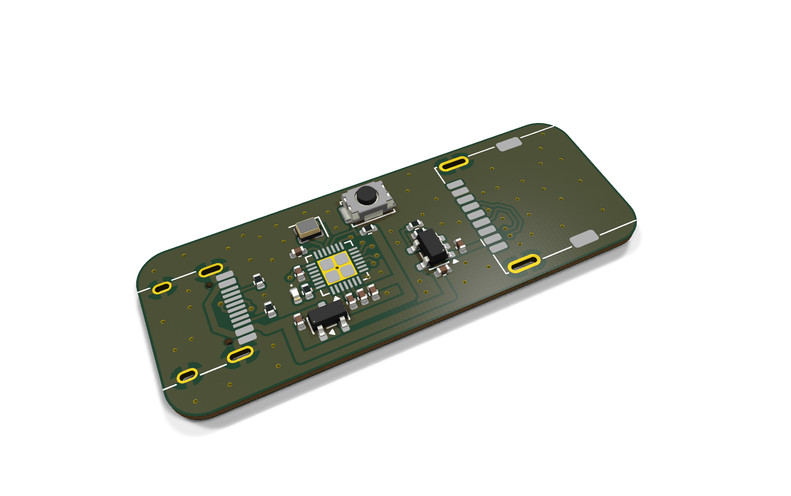
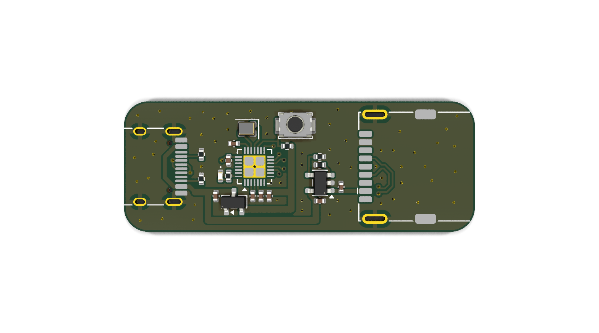
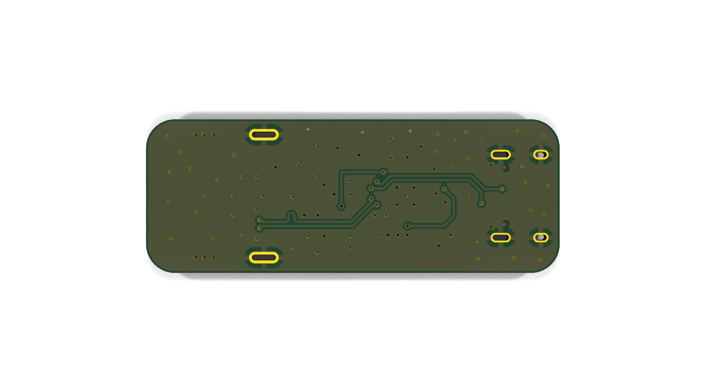

<p align="center">
  
</p>

<h1 align="center">Flasher</h1>

<p align="center">
  基于 WCH CH582F 的 USB ISP 烧录器与 USB ↔ UART 透传工具
</p>

<p align="center">
  <a href="LICENSE"></a>
  
  
  
</p>

> A compact CH582F-based USB ISP flasher and USB ↔ UART bridge for WCH CH570/CH572 dongles.

## 简介

Flasher 是一块 USB 棒形态的小板：USB-C 接电脑，USB-A 接目标板。它可以在两种角色间切换：

- **烧录器**：作为 USB Host 接管目标板，进入 WCH 的 USB ISP Bootloader，完成识别、解锁、擦除、写入与校验。
- **透传桥**：把电脑的 CDC 串口桥接到目标板的 USB CDC/Bulk 端点，或者把 USB-A 上的 D-/D+ 复用为 3.3 V TTL UART。

固件为裸机 C++17，直接操作 CH582F 寄存器，不依赖 WCH SDK；上位机脚本 `firmware/tools/flasher.py` 提供命令行操作。

## 功能特性

- **USB-C 供电与通信**：CH582F 原生 USB2.0 全速设备，枚举为 CDC ACM（`1A86:5721`）。
- **目标 USB-A 口**：支持 USB Host 枚举，板载 MT9700 负载开关可通过 `PB4` 独立控制目标 VBUS，实现硬复位/重新上电。
- **WCH ISP 烧录**：识别 `4348:55E0` / `1A86:55E0` Bootloader，支持 CH570/CH572 的解锁流程（清理 code flash 标记 / `CFG_DEBUG_EN`）、整片擦除、分块写入与回读校验，最大 240 KiB。
- **Master 透传**：PC CDC ↔ 目标 CDC/Bulk，同步 `SET_LINE_CODING` 与 `SET_CONTROL_LINE_STATE`（DTR/RTS）。
- **Slave 透传**：PC CDC ↔ USB-A 引脚上的 UART1（PB13 TX / PB12 RX），波特率跟随 PC 端串口设置。
- **状态指示**：USB 枚举成功后 LED 常亮，否则 500 ms 闪烁；BOOT 按键可让 CH582F 自身进入下载模式。
- **生产就绪**：提供 Gerber、BOM、坐标文件与 IPC 网表。

## 硬件

| 项目 | 参数 |
| --- | --- |
| MCU | WCH CH582F（RISC-V，448 KB Flash / 32 KB RAM，双 USB2.0 全速） |
| 主时钟 | 32 MHz 无源晶振，PLL 480 MHz / 6 = 80 MHz |
| 电脑侧接口 | USB-C（HRO TYPE-C-31-M-12），CC 5.1 kΩ 下拉 |
| 目标侧接口 | USB-A（XKB U231-091N-4BLRA00-S） |
| 3.3 V 电源 | HR6206A33T3 LDO |
| 目标 VBUS 开关 | MT9700 负载开关，`PB4` 使能 |
| 指示/按键 | LED（`PA12`，高有效）、BOOT 按键（`PB22`） |
| PCB | 43 × 16 mm，2 层，0.8 mm 厚，圆角 |

<p align="center">
  
</p>

上图为 KiCad 10 通过 `kicad-cli pcb render` 生成的真实 3D 渲染（非布局截图）。元件全部布置在正面，背面可查看走线与铺铜。

<details>
<summary>查看背面 3D 渲染</summary>

<p align="center">
  
</p>

</details>

## 仓库结构

```
.
├── Flasher.kicad_pro / .kicad_sch / .kicad_pcb   # KiCad 工程（原理图 + PCB）
├── Custom.kicad_sym                              # 自定义符号库
├── production/                                   # Gerber、BOM、坐标、IPC 网表
├── docs/images/                                  # KiCad 3D 渲染图
└── firmware/
    ├── Makefile                                  # RISC-V GCC 构建
    ├── ld/ch582.ld                               # 链接脚本
    ├── include/ch582/                            # 寄存器、USB、ISP、UART 等头文件
    ├── src/                                      # 裸机固件与中断启动代码
    └── tools/flasher.py                          # PC 端命令行工具
```

## 固件构建

### 依赖

- GNU Make
- MounRiver Studio 3 自带的 WCH RISC-V Embedded GCC 工具链
  （默认路径 `C:/MounRiver/MounRiver_Studio3/resources/app/resources/win32/components/WCH/Toolchain/RISC-V Embedded GCC15/bin`）

### 编译

```bash
cd firmware
make
```

若工具链不在默认位置：

```bash
make MRS_TOOLCHAIN="/path/to/RISC-V Embedded GCC/bin"
```

输出位于 `firmware/build/`：

| 文件 | 说明 |
| --- | --- |
| `flasher.hex` | Intel HEX，烧录到 CH582F |
| `flasher.bin` | 原始二进制 |
| `flasher.elf` / `.map` | 调试符号与内存映射 |

### 给 Flasher 本身烧录固件

1. 按住 **BOOT** 键（拉低 `PB22`）。
2. 通过 USB-C 接入电脑，CH582F 进入内置 USB ISP 模式。
3. 使用 WCHISPTool 选择 `firmware/build/flasher.hex` 下载到 `0x00000000`。
4. 重新上电，设备枚举为 CDC 串口 `1A86:5721`。

## 使用

### 安装上位机依赖

```bash
pip install pyserial
```

`flasher.py` 可自动按 VID/PID 查找串口，也可以显式指定 `--port COMx`。

### 常用命令

```bash
# 查看协议版本、当前模式、目标类型与 VID/PID
python flasher.py --port COM7 info

# Master 透传：桥接 USB-A 上的目标设备，并打开终端监视
python flasher.py --port COM7 master --monitor

# Slave 透传：USB-A 作为 115200 8N1 的 3.3V UART
python flasher.py --port COM7 slave --baud 115200 --monitor

# 通过 WCH ISP 烧录镜像，写入后回读校验
python flasher.py --port COM7 flash firmware.bin --verify

# 目标电源控制：off / app / isp
python flasher.py --port COM7 power isp

# 发送 BREAK，从透传模式返回命令模式
python flasher.py --port COM7 reset
```

> 透传模式下串口为原始字节流；发送 **BREAK** 可随时打断桥接并回到命令模式。Windows 下 USB BREAK 可能滞后于后续数据，脚本会自动重试 PING 确认。

## 串口协议

命令模式固定使用 115200 8N1，帧格式如下（多字节字段均为小端）：

```
请求:  AA 55 | CMD | LEN | PAYLOAD[LEN] | CRC8
应答:  55 AA | CMD | LEN | PAYLOAD[LEN] | CRC8
```

- `CRC8`：多项式 `0x07`，初值 `0x00`，覆盖 `CMD | LEN | PAYLOAD`。
- `LEN` 最大 64；ISP 数据块为 4 字节地址 + 56 字节数据。

| CMD | 名称 | 请求载荷 | 说明 |
| --- | --- | --- | --- |
| `0x01` | PING | — | 返回状态、协议版本、模式、目标类型、VID/PID |
| `0x02` | INFO | — | 同 PING |
| `0x03` | SET_MODE | `mode [, baud:u32]` | `0` 空闲 / `1` Master / `2` Slave |
| `0x04` | POWER | `on, boot` | `0` 断电；`1,0` 上电到应用；`1,1` 上电到 Bootloader |
| `0x10` | ISP_BEGIN | `size:u32` | 进入 ISP、解锁并擦除，返回芯片信息与 UID |
| `0x11` | ISP_WRITE | `addr:u32 + data` | 写入最多 56 字节 |
| `0x12` | ISP_VERIFY | `addr:u32 + data` | 回读校验 |
| `0x13` | ISP_FINISH | — | 结束会话并把目标复位到应用 |

| 状态码 | 含义 |
| --- | --- |
| `0x00` | OK |
| `0x01` | 未知命令 |
| `0x02` | 参数错误 |
| `0x03` | 未检测到目标 |
| `0x04` | USB 错误 |
| `0x05` | ISP 错误 |
| `0x07` | 不支持 |

## 实现要点

- **USB Host 电源时序**：Slave 模式下先在数据线悬空时给目标上电，让目标 Bootloader 采样到 D+ 为低并启动应用，随后再初始化 UART；否则 D+ 被驱动为高会把目标困在 ISP 模式。
- **ISP 解锁**：部分 CH570/CH572 需要先清除代码区标记或 `CFG_DEBUG_EN`，解锁后重新枚举再执行擦写。
- **零长度包**：USB 传输对 64 字节整数倍长度会补 ZLP，保证端点事务正常结束。
- **锁定与中断安全**：CDC 行编码/控制线状态通过 generation 计数同步，关键区使用 `CriticalSection` 关中断保护。
- **无 SDK 依赖**：`include/ch582/platform/registers.hpp` 自行定义外设寄存器与中断号，便于裁剪和审计。

## 3D 渲染与生产文件

3D 图片由 KiCad 10 命令行直接渲染：

```bash
kicad-cli pcb render --width 1600 --height 900 --quality high \
  --side top --background transparent --floor --perspective --zoom 1.05 \
  -o docs/images/board-top.png Flasher.kicad_pcb

kicad-cli pcb render --width 1600 --height 1000 --quality high \
  --side top --background transparent --floor --perspective \
  --rotate "-35,0,25" -o docs/images/board-iso.png Flasher.kicad_pcb

kicad-cli pcb render --width 1600 --height 900 --quality high \
  --side bottom --background transparent --floor --perspective --zoom 1.05 \
  -o docs/images/board-bottom.png Flasher.kicad_pcb
```

`production/Flasher-1.0.zip` 包含可直接送厂的 Gerber；BOM、元件坐标与 IPC 网表位于同一目录。

## 许可证

本项目采用 [Apache License 2.0](LICENSE) 开源。

Copyright 2026 Windmill_City

---

相关链接：[WCH CH582 产品页](https://www.wch.cn/products/CH582.html) · [项目仓库](https://github.com/Windmill-City/Flasher)
